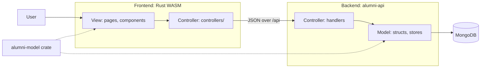
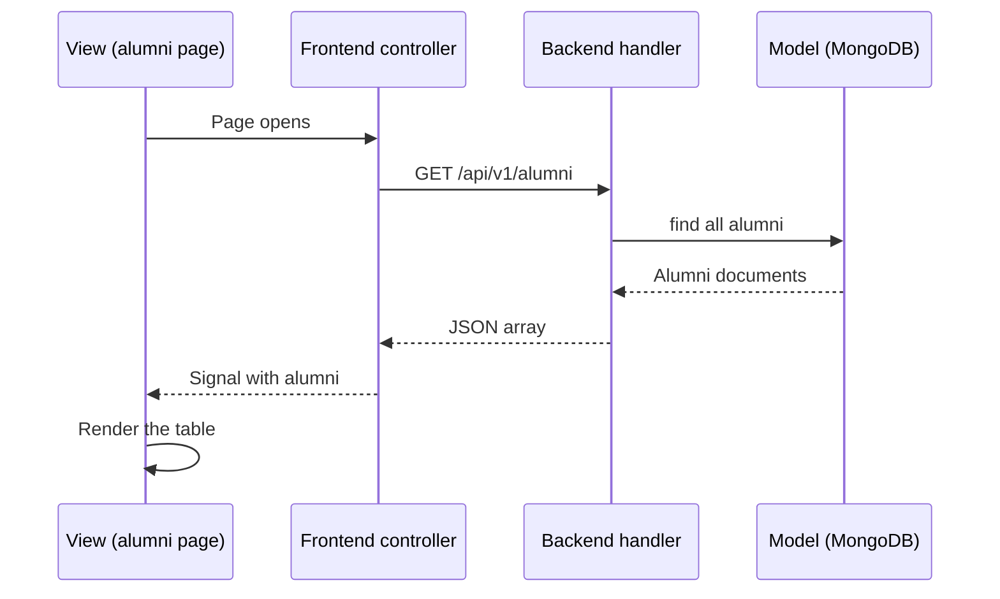

# Alumni Tracking System

This is an alumni tracking app for the Web Development class of fall 2026-2027.

## Writing style

Write the README and all files in `docs/` in Simplified Technical English (ASD-STE100).

- Use short sentences. Use the active voice.
- Use one term for one thing. Do not use synonyms.
- Use the imperative form for steps.
- Do not use idioms, contractions, or abbreviations that you do not define.

## Status

The backend and frontend are Rust and run today. The frontend is a Rust WASM app built with
Leptos and Trunk. The React frontend is gone.

## Stack

- **Backend:** Rust, actix-web 4, MongoDB (official driver). Service: `alumni-api`.
- **Frontend:** Rust compiled to WASM. Framework: Leptos in client-side rendering (CSR)
  mode. Build tool: Trunk. Styling: plain CSS. nginx serves the built files.
- **Shared model (planned):** one Rust crate, `alumni-model`, used by the backend and the frontend.
- **Database:** MongoDB 7.
- **Runtime:** all parts run in Docker with `docker compose`.

## Layout

```
alumni/
  services/alumni-api/    # Rust actix-web backend
  frontend/               # Rust + Leptos WASM client
  crates/alumni-model/    # Shared Model structs (planned)
  docs/                   # backlog, done log, trade-offs, architecture diagrams
  docker-compose.yml
  AGENTS.md
```

## MVC structure

The system uses the Model-View-Controller (MVC) pattern across the whole stack.

| Layer | Job | Where it lives |
| --- | --- | --- |
| Model | Holds the data, the data rules and the data storage. | `alumni-model` crate, `alumni-api` data code, MongoDB |
| View | Shows data to the user. | Leptos pages and components, nginx |
| Controller | Receives input, calls the Model and selects the result. | `alumni-api` handlers, frontend `controllers/` module |



### Request flow: list the alumni



### Backend mapping (current code)

Docker Compose starts all layers. It is the shared wiring and is not part of one layer.

| Layer | Part | File or container |
| --- | --- | --- |
| Model | Data shapes `Alumni`, `Announcement`, `JobPosting`, and `JobApplication` with their create/update DTOs | `services/alumni-api/src/models.rs` |
| Model | MongoDB stores with `create`, `get`, `list`, `replace`, `update`, `delete` | `services/alumni-api/src/alumni_store.rs`, `services/alumni-api/src/announcement_store.rs`, `services/alumni-api/src/job_posting_store.rs`, `services/alumni-api/src/job_application_store.rs` |
| Model | Atomic id counters (`alumni`, `announcements`, `job_postings`, `job_applications`) | `counters` collection, used inside the stores |
| Model | Data rules: name, email, year, degree, title, body, posting, and application status checks plus the `ModelError` type | `services/alumni-api/src/models.rs` |
| Model | Database settings and bind address | `services/alumni-api/src/config.rs` |
| Model | Sample data and import | `services/alumni-api/seed/`, `mongo-seed` container |
| Model | Database | `mongo` container |
| Controller | Route functions for health, hello and sum | `services/alumni-api/src/handlers.rs` |
| Controller | `ApiAlumniController`: functions for the alumni JSON CRUD | `services/alumni-api/src/controllers/api_alumni_controller.rs` |
| Controller | `AnnouncementController`: functions for the announcement pages (list, create, show, edit, update, delete) | `services/alumni-api/src/controllers/announcement_controller.rs` |
| Controller | `ApiAnnouncementController`: functions for the announcement JSON CRUD | `services/alumni-api/src/controllers/api_announcement_controller.rs` |
| Controller | `ApiJobPostingController`: functions for the job posting JSON CRUD | `services/alumni-api/src/controllers/api_job_posting_controller.rs` |
| Controller | `ApiJobApplicationController`: functions for the job application JSON CRUD | `services/alumni-api/src/controllers/api_job_application_controller.rs` |
| Controller | Route tables: `api_alumni.rs` (JSON), `announcement.rs` (pages), `api_announcement.rs` (JSON), `api_job_posting.rs` (JSON), and `api_job_application.rs` (JSON) | `services/alumni-api/src/routes/` |
| Controller | Error type and HTTP status mapping `ApiError` | `services/alumni-api/src/error.rs` |
| Controller | Stores, `/api/v1` scope, indexes, OpenAPI and Swagger UI | `services/alumni-api/src/main.rs` |
| View | HTML pages for announcements (maud templates) | `services/alumni-api/src/views/` |
| View | JSON responses that the API returns | Serde derive on the Model structs |

### Frontend mapping

| Layer | Part | Location |
| --- | --- | --- |
| Model | `Alumni`, `JobPosting`, and `JobApplication` structs | `frontend/src/api.rs` (until the shared crate exists) |
| Controller | API client and page signals | `frontend/src/api.rs`, `frontend/src/pages/` |
| Controller | Route table | `frontend/src/main.rs` |
| View | Page components | `frontend/src/pages/` |
| View | Shared components (layout, theme toggle, navigation) | `frontend/src/components.rs` |
| View | Plain CSS styles | `frontend/style.css` |
| View | Static file server | `frontend` container (nginx) |

### Rules

- A View must call the API only through `frontend/src/api.rs`.
- A controller must not hold data rules. It must call the Model.
- The Model must not know about HTTP, routes or pages.
- The backend and the frontend must import shared types from `alumni-model` when the crate exists. Until then, `frontend/src/api.rs` mirrors the JSON shapes.

### Known gaps

- The `alumni-model` crate and the `crates/` folder are not in the repository yet. The frontend
  mirrors the API JSON shapes in `frontend/src/api.rs`.
- Docker builds for `alumni-api` and the frontend must use the repository root as build context
  to read the shared crate.
- Filter queries scan: no indexes exist on `graduation_year`, `degree`, or `full_name` yet.
- `cargo test` needs MongoDB on `localhost:27017` (or sets `MONGO_URI`).
- `docs/ddd.md` defines the target database design. The code follows it.
- Job application status history and reviewer actions are not implemented.

## Run

All services run in Docker. You do not need a host toolchain.

```bash
docker compose up --build
```

Then open these addresses:

- Frontend: http://localhost (nginx serves the built app on port 80)
- API: http://localhost:8080/api/v1/alumni

The first `up` command fills MongoDB with sample alumni, job postings, and applications. The
`mongo-seed` container does this.

## Routes

The SPA has these pages: `/` (home), `/alumni` (list), `/jobs` (list and filters),
`/jobs/{id}` (detail and apply form), `/applications` (list, filters, and status update), and
`/about` (placeholder with a Prufrock poem). For an unknown path, the SPA shows the 404 page.

The API has these routes under `/api/v1`. Use port 8080 for the API or port 80 for the gateway.

| Route | Returns |
| --- | --- |
| `GET /api/v1/alumni` | The alumni from MongoDB |
| `GET /api/v1/hello` | `"hello, world"` |
| `GET /api/v1/hello/{variable}` | `"hello, {variable}!"` |
| `GET /api/v1/sum/{num1}/{num2}` | `num1 + num2` as a bare JSON number (f64) |

`ApiAlumniController` serves the alumni JSON routes under `/api/v1/alumni`.
All data lives in MongoDB. A duplicate email fails with status 400. Delete of
an alumni record with announcements fails with status 400.
See `docs/trade-offs.md`.

| Route | Returns |
| --- | --- |
| `POST /api/v1/alumni` | The new alumni record (status 201). Fields: `full_name`, `email`, `graduation_year`, `degree` |
| `GET /api/v1/alumni` | All alumni records, ordered by id |
| `GET /api/v1/alumni/{id}` | One alumni record, or status 404 |
| `PUT /api/v1/alumni/{id}` | Full replacement, or status 404 |
| `PATCH /api/v1/alumni/{id}` | Partial update, or status 404 |
| `DELETE /api/v1/alumni/{id}` | Status 204, 400, or 404 |
| `GET /api/health` | `{"status": "ok"}` |
| `GET /api/swagger` | Swagger UI (redirects to `/api/swagger/`) |

`ApiAnnouncementController` serves the announcement JSON routes under
`/api/v1/announcements`. The same routes also work under `/api/announcements`.
Each announcement links to an alumni record through `author_id`. An unknown
`author_id` fails with status 400.

| Route | Returns |
| --- | --- |
| `POST /api/v1/announcements` | The new announcement (status 201). Fields: `title`, `body`, `author_id` |
| `GET /api/v1/announcements` | All announcements, ordered by id |
| `GET /api/v1/announcements/{id}` | One announcement, or status 404 |
| `PUT /api/v1/announcements/{id}` | Full replacement, or status 404 |
| `PATCH /api/v1/announcements/{id}` | Partial update, or status 404 |
| `DELETE /api/v1/announcements/{id}` | Status 204, or status 404 |

`ApiJobPostingController` serves the job posting JSON routes under
`/api/v1/job-postings`. Each posting links to an alumni record through
`author_id`. An unknown `author_id` fails with status 400. `is_active`
defaults to `true`; use `GET /api/v1/job-postings?active=true` to hide
inactive rows. Delete of an alumni record with job postings fails with
status 400.

| Route | Returns |
| --- | --- |
| `POST /api/v1/job-postings` | The new job posting (status 201). Fields: `title`, `company`, `description`, `location`, `employment_type`, `apply_url`, `author_id`, optional `is_active` |
| `GET /api/v1/job-postings` | All job postings, ordered by id. Optional query: `active=true` or `active=false` |
| `GET /api/v1/job-postings/{id}` | One job posting, or status 404 |
| `PUT /api/v1/job-postings/{id}` | Full replacement, or status 404 |
| `PATCH /api/v1/job-postings/{id}` | Partial update, or status 404 |
| `DELETE /api/v1/job-postings/{id}` | Status 204, or status 404 |

`ApiJobApplicationController` serves the job application JSON routes under
`/api/v1/job-applications`. Each application links to one posting and one alumni.
A duplicate application fails with status 400. Status values: `submitted`,
`reviewed`, `accepted`, `rejected`; the default is `submitted`. Delete of a
posting or an alumni with applications fails with status 400.

| Route | Returns |
| --- | --- |
| `POST /api/v1/job-applications` | The new application (status 201). Fields: `job_posting_id`, `alumni_id`, `cover_letter`, optional `status` |
| `GET /api/v1/job-applications` | All applications, ordered by id. Optional query: `job_posting_id`, `alumni_id`, `status` |
| `GET /api/v1/job-applications/{id}` | One application, or status 404 |
| `PUT /api/v1/job-applications/{id}` | Full replacement, or status 404 |
| `PATCH /api/v1/job-applications/{id}` | Partial update, or status 404 |
| `DELETE /api/v1/job-applications/{id}` | Status 204, or status 404 |
| `GET /api/v1/job-postings/{id}/applications` | Applications for one posting |

`AnnouncementController` serves the announcement pages as HTML. An HTML form sends only GET and POST. For this
reason, update and delete are POST routes. After a successful change, the page redirects
(status 303). If the input is not valid, the page shows the error with status 400. If the announcement
does not exist, the page shows an HTML 404 page.

| Route | Returns |
| --- | --- |
| `GET /announcements` | The announcement list and the create form |
| `POST /announcements` | Creates an announcement from the form fields `title`, `body` and `author_id` |
| `GET /announcements/{id}` | The page for one announcement |
| `GET /announcements/{id}/edit` | The edit form for one announcement |
| `POST /announcements/{id}` | Replaces `title`, `body` and `author_id` of one announcement |
| `POST /announcements/{id}/delete` | Deletes one announcement |

The Swagger UI shows all routes, grouped by the tags `ApiAlumniController`,
`AnnouncementController`, `ApiAnnouncementController`,
`ApiJobPostingController`, and `ApiJobApplicationController`:
http://localhost:8080/api/swagger. The gateway also serves it at
http://localhost/api/swagger. The gateway proxies `/announcements` to the API.

The gateway on port 80 proxies these short routes to the API: `/hello`, `/hello/{variable}` and
`/sum/{num1}/{num2}`. They return the same responses as the routes without the `/api/v1` prefix.
See `docs/trade-offs.md`.

## Documentation

- `docs/architecture/` - Mermaid diagrams (system context, containers, read flow) and how to view them.
- `docs/backlog.md` - planned work, in priority order.
- `docs/done.md` - log of completed work.
- `docs/trade-offs.md` - decisions and compromises.
- `docs/ddd.md` - target database design (collections, indexes, data rules).

Read `AGENTS.md` for the rules that agents and contributors must obey.
