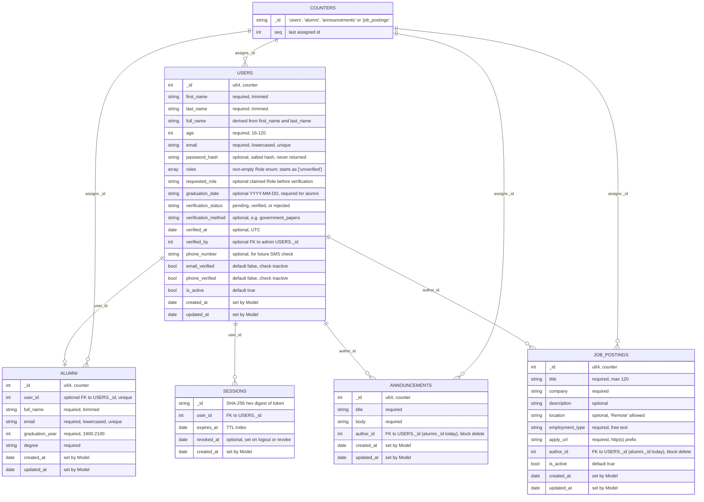

# Database Design Document (DDD)

Status: implemented for `alumni`, `announcements`, `job_postings`, `counters`,
auth (`register`, `login`, `logout`, `me` on `users` and `sessions`),
role/ownership middleware (`AuthMiddleware`), and admin paper-verification and
role-management endpoints (`/api/v1/admin/*`).
The code currently follows this document for `alumni`, `announcements`,
`job_postings`, and `counters`.
Today `alumni`, `announcements`, `job_postings`, and `counters` live in MongoDB.
See `services/alumni-api/src/main.rs` and `docs/trade-offs.md`.

This document follows `README.md`. It uses one term for one thing.
It uses short sentences and the active voice.

## Terms

- `User`: one account record with credentials and roles.
  It lives in the `users` collection (target design).
- `Role`: one authorization label on a `User`.
  Allowed values: `unverified`, `undergrad`, `grad`, `phd`, `alumni`,
  `academic`, `professor`, and `admin`.
- `Session`: one active login record.
  It lives in the `sessions` collection (target design).
- `Alumni`: one graduate profile record. It lives in the `alumni` collection.
- `Announcement`: one news record. It lives in the `announcements` collection.
- `Job posting`: one job offer that an authorized user publishes.
  It lives in the `job_postings` collection.
- `Counter`: one id counter record. It lives in the `counters` collection.
- `alumni-model`: the shared Rust crate (planned, see `README.md` Layout).
  It holds the structs, the data rules, and the authorization rules.
  The backend and the frontend import structs from it. No code copies structs.
- `Model`: structs, data rules, authorization rules, stores, and MongoDB.
- `Controller`: handlers. They call the Model. They hold no data rules or
  authorization rules.
- `View`: JSON responses built with serde. Views hold no data rules.

## Database

- Server: MongoDB 7, container `mongo` on port 27017.
- Database name: `alumni` (env `MONGO_DB`).
- Implemented collections: `alumni`, `announcements`, `job_postings`, `counters`.
- Target collections for authorization: `users`, `sessions`.

## Users schema (target design)

One document per account. The `alumni-model` crate will hold this struct.
The API never returns `password_hash`.

| Field | BSON type | Rust type | Required | Rule |
| --- | --- | --- | --- | --- |
| `_id` | int64 | u64, range `1..=i64::MAX` | yes | Server counter assigns it. Never reuse it. |
| `first_name` | string | String | yes | Trim it. Reject empty. |
| `last_name` | string | String | yes | Trim it. Reject empty. |
| `full_name` | string | String | yes | Derived as `"{first_name} {last_name}"`. |
| `age` | int32 | u8 | yes | Range `16..=120`. |
| `email` | string | String | yes | Trim it. Lowercase it. Must contain `@` with non-empty parts. Unique. |
| `password_hash` | string | Option\<String\> | no | Salted hash (PBKDF2-HMAC-SHA256 or Argon2id). Never serialize it. |
| `roles` | array of string | Vec\<Role\> | yes | Non-empty. Unique values from `Role` enum. Starts as `["unverified"]`. |
| `requested_role` | string | Option\<Role\> | no | Claimed role on registration (`undergrad`, `grad`, `phd`, `alumni`, `academic`, or `professor`). |
| `graduation_date` | string | Option\<String\> | no | Optional ISO date (`YYYY-MM-DD`). Required when requesting `alumni`. |
| `verification_status` | string | VerificationStatus | yes | `"pending"`, `"verified"`, or `"rejected"`. Default `"pending"` on registration. |
| `verification_method` | string | Option\<String\> | no | Set to `"government_papers"` when an `admin` verifies the account. |
| `verified_at` | date | Option\<bson::DateTime\> | no | UTC time when an `admin` verifies government papers. |
| `verified_by` | int64 | Option\<u64\> | no | `users._id` of the `admin` who verified the papers. |
| `phone_number` | string | Option\<String\> | no | Optional phone number for future SMS checks. |
| `email_verified` | bool | bool | yes | Default `false`. Set by future email verification check (inactive). |
| `phone_verified` | bool | bool | yes | Default `false`. Set by future SMS verification check (inactive). |
| `is_active` | bool | bool | yes | Default `true` on create. `false` blocks login and active sessions. |
| `created_at` | date | bson::DateTime | yes | Model sets it on create. UTC. |
| `updated_at` | date | bson::DateTime | yes | Model sets it on create and on each update. UTC. |

Roles:

- `unverified`: newly registered user before government-paper verification.
- `undergrad`: undergraduate student.
- `grad`: graduate student (master's or non-doctoral postgraduate).
- `phd`: doctoral student or candidate.
- `alumni`: graduate who completed a degree.
- `academic`: academic staff (lecturer, researcher, or teaching assistant).
- `professor`: faculty professor.
- `admin`: system administrator and class admin.

Rules:

- `roles` accepts only values from the `Role` enum in `alumni-model`.
  Add new student or staff roles (for example, `postdoc` or `staff`) to
  that enum before storing them.
- Every newly registered `User` starts with `roles: ["unverified"]` and
  `verification_status: "pending"` until identity and status are proven with
  government papers.
- An `admin` inspects government papers and promotes the `User` from
  `unverified` to `requested_role`, setting `verification_status: "verified"`,
  `verification_method: "government_papers"`, `verified_at`, and `verified_by`.
- A verified `User` holds at least one role. The Model deduplicates `roles` on
  write. A user can hold multiple roles (for example, `professor` and `admin`,
  or `alumni` and `grad`).
- Email and SMS verification checks (`REQUIRE_EMAIL_VERIFICATION` and
  `REQUIRE_SMS_VERIFICATION`) exist in code as disabled flags (`false`).
  They do not block registration or login until activated.
- The Model lowercases `email` before each write.
  The unique index then works with one rule in one place.
- Duplicate `email` fails in MongoDB with error `11000`.
  The Controller maps `11000` to status `400`.
- `password_hash` uses salted PBKDF2-HMAC-SHA256 (or Argon2id). Absent
  `password_hash` disables password login for migrated seed accounts until
  the user sets a password.
- Self-registration requires `first_name`, `last_name`, `age`, `email`,
  `password`, and either an academic status (`undergrad`, `grad`, `phd`,
  `academic`, `professor`) or a `graduation_date` (which sets `requested_role`
  to `alumni`).
- `graduation_date` uses `YYYY-MM-DD` format in `1900..=2100`.
- The Model sets `full_name` from `first_name` and `last_name` and sets
  timestamps. Controllers never set them.
- Sort by `_id`. Counter order equals time order.

## Sessions schema (target design)

One document per active login session.

| Field | BSON type | Rust type | Required | Rule |
| --- | --- | --- | --- | --- |
| `_id` | string | String | yes | SHA-256 hex digest of the raw session token. |
| `user_id` | int64 | u64 | yes | Must equal an existing `users._id`. |
| `expires_at` | date | bson::DateTime | yes | UTC expiry time. MongoDB TTL index removes expired rows. |
| `revoked_at` | date | Option\<bson::DateTime\> | no | Set on logout or admin revoke. Absent while active. |
| `created_at` | date | bson::DateTime | yes | Model sets it on create. UTC. |

Rules:

- Generate each raw session token from 32 cryptographically random bytes.
  Return the raw token once on login; store only its SHA-256 digest in `_id`.
- Do not use `counters` for `sessions._id`. Sequential session ids are
  predictable.
- Reject a session when `expires_at <= now`, `revoked_at` is present, or the
  linked `User` has `is_active: false`.
- Logout sets `revoked_at` to `now` (or deletes the row).
- Disabling a `User` or changing a user's `roles` revokes all active sessions
  for that `user_id`.

## Authorization rules (target design)

The Model enforces role and ownership checks. Controllers extract the current
`User` from the session and map failures to HTTP status codes.

### Role permissions

| Resource and action | `unverified` | `undergrad`, `grad`, `phd` | `alumni` | `academic`, `professor` | `admin` |
| --- | --- | --- | --- | --- | --- |
| `users` read own (`/users/me`) | yes | yes | yes | yes | yes |
| `users` read directory | no | no | no | yes (public fields only) | yes |
| `users` create, assign `roles`, verify papers, toggle `is_active`, delete | no | no | no | no | yes |
| `users` update own `full_name` or password | yes | yes | yes | yes | yes |
| `alumni` read list and detail | no | yes | yes | yes | yes |
| `alumni` create or delete | no | no | no | no | yes |
| `alumni` update | no | no | own linked record only | no | yes |
| `announcements` read | no | yes | yes | yes | yes |
| `announcements` create | no | no | no | yes | yes |
| `announcements` update or delete | no | no | no | own only | yes |
| `job_postings` read active | no | yes | yes | yes | yes |
| `job_postings` read inactive | no | no | own only | own only | yes |
| `job_postings` create | no | no | yes | yes | yes |
| `job_postings` update, toggle `is_active`, delete | no | no | own only | own only | yes |
| `sessions` logout own | yes | yes | yes | yes | yes |
| `sessions` revoke any user | no | no | no | no | yes |

Rules:

- Public endpoints (no session required): `GET /api/health`,
  `GET /api/v1/hello*`, `GET /api/v1/sum*`, `GET /api/swagger*`,
  `GET /api/openapi.json`, `POST /api/v1/auth/login`, and
  `POST /api/v1/auth/register`.
- Self-registration (`POST /api/v1/auth/register`) accepts a `requested_role`
  of `undergrad`, `grad`, `phd`, `alumni`, `academic`, or `professor` (requests
  for `admin` fail with status `403`). The created account starts with
  `roles: ["unverified"]` and `verification_status: "pending"`.
- Only `admin` can verify government papers, promote an `unverified` account,
  assign `roles`, or change `is_active`.
- When a user holds multiple roles, the Model grants the union of those roles'
  permissions.
- Ownership checks compare `author_id == current_user._id` for `announcements`
  and `job_postings`, and `alumni.user_id == current_user._id` for `alumni`.
- For non-admin authors, the Controller sets `author_id` from the session's
  `user_id`. A mismatched client-supplied `author_id` fails with status `403`.
- Unauthenticated requests to protected routes fail with status `401`.
- Authenticated requests that lack the required role or ownership fail with
  status `403`.

## Alumni schema

One document per graduate. The `alumni-model` crate will hold this struct.
The API never returns `password_hash`.

| Field | BSON type | Rust type | Required | Rule |
| --- | --- | --- | --- | --- |
| `_id` | int64 | u64, range `1..=i64::MAX` | yes | Server counter assigns it. Never reuse it. |
| `user_id` | int64 | Option\<u64\> | no | Target design: optional FK to `users._id`. Unique when present. |
| `full_name` | string | String | yes | Trim it. Reject empty. |
| `email` | string | String | yes | Trim it. Lowercase it. Must contain `@` with non-empty parts. Unique. |
| `graduation_year` | int32 | i32 | yes | Range `1900..=2100`. |
| `degree` | string | String | yes | Trim it. Reject empty. Free text, no enum yet. |
| `password_hash` | string | Option\<String\> | no | Current code reserve only. Moves to `users.password_hash` when auth lands. |
| `created_at` | date | bson::DateTime | yes | Model sets it on create. UTC. |
| `updated_at` | date | bson::DateTime | yes | Model sets it on create and on each update. UTC. |

Rules:

- All profile fields are required. `user_id` and `password_hash` are optional.
- In the target design, `user_id` links an `Alumni` record to a `User` account.
  Unlinked rows (such as historical or seed rows without login) omit `user_id`.
- When a linked `User` updates `full_name` or `email`, the Model updates the
  matching `alumni` document so directory reads stay join-free.
- The Model lowercases `email` before each write.
  The unique index then works with one rule in one place.
- Duplicate `email` fails in MongoDB with error `11000`.
  The Controller maps `11000` to status `400`.
- The Model sets timestamps. Controllers never set them.
- Sort by `_id`. Counter order equals time order.

## Announcements schema

One document per news record. The `alumni-model` crate will hold this struct.

| Field | BSON type | Rust type | Required | Rule |
| --- | --- | --- | --- | --- |
| `_id` | int64 | u64, range `1..=i64::MAX` | yes | Server counter assigns it. Never reuse it. |
| `title` | string | String | yes | Trim it. Reject empty. |
| `body` | string | String | yes | Trim it. Reject empty. |
| `author_id` | int64 | u64 | yes | Current code: `alumni._id`. Target design: `users._id`. |
| `created_at` | date | bson::DateTime | yes | Model sets it on create. UTC. |
| `updated_at` | date | bson::DateTime | yes | Model sets it on create and on each update. UTC. |

Rules:

- `author_id` replaces the old free-text `author` field.
- In the target design, `author_id` references `users._id` so `academic`,
  `professor`, and `admin` accounts can publish announcements without an
  `alumni` record.
- Delete of an author record (`alumni` today, `users` in the target design)
  with announcements fails with status `400`.
  The Model checks `announcements` by `author_id` before it deletes.
- Sort by `_id`.

## Job postings schema

One document per job offer. The `alumni-model` crate will hold this struct.

| Field | BSON type | Rust type | Required | Rule |
| --- | --- | --- | --- | --- |
| `_id` | int64 | u64, range `1..=i64::MAX` | yes | Server counter assigns it. Never reuse it. |
| `title` | string | String | yes | Trim it. Reject empty. At most 120 characters. |
| `company` | string | String | yes | Trim it. Reject empty. |
| `description` | string | String | no | Optional. Trim it. Absent stores as an empty string. |
| `location` | string | String | no | Optional. Trim it. Use `"Remote"` for remote work. Absent stores as an empty string. |
| `employment_type` | string | String | yes | Trim it. Reject empty. Free text, no enum yet. |
| `apply_url` | string | String | yes | Trim it. Reject empty. Must start with `http://` or `https://`. |
| `author_id` | int64 | u64 | yes | Current code: `alumni._id`. Target design: `users._id`. |
| `is_active` | bool | bool | yes | Default `true` on create. `false` hides the posting from active lists. |
| `created_at` | date | bson::DateTime | yes | Model sets it on create. UTC. |
| `updated_at` | date | bson::DateTime | yes | Model sets it on create and on each update. UTC. |

Rules:

- `title` is required and at most 120 characters. `company` is required.
  `description` and `location` are optional; the Model stores an empty string
  when a request omits them.
- `author_id` links the posting to the publisher record (`alumni._id` today,
  `users._id` in the target design).
- Delete of an author record (`alumni` today, `users` in the target design)
  with job postings fails with status `400`.
  The Model checks `job_postings` by `author_id` before it deletes.
- The Model sets `is_active` to `true` when the create or replace request
  omits it.
- The list route filters with `active=true` or `active=false`.
  It returns all authorized postings when the query is absent.
- The Model does not open `apply_url`. It checks the prefix only.
- Sort by `_id`.

## Counters schema

One document per id series. It replaces `AtomicU64` in the old memory stores.

| Field | BSON type | Rust type | Required | Rule |
| --- | --- | --- | --- | --- |
| `_id` | string | String | yes | `"alumni"`, `"announcements"`, `"job_postings"`, or `"users"` (target). |
| `seq` | int64 | u64 | yes | Last assigned id. |

Rules:

- Assign ids with one atomic call: `findOneAndUpdate` with `$inc: {seq: 1}`,
  `upsert: true`, return-new. No `max + 1` reads.
- Start at `1`. Never go back. Deletes never return ids to the pool.
- The call runs inside the Model create function, not in the Controller.
- Do not create a counter for `sessions`.

## Indexes

Create indexes at API startup with `create_index`, or in the collection
migration when no API code exists yet. Repeat runs must succeed.

Implemented:

- `alumni._id`: default primary index.
- `alumni.email`: unique index. No collation. App-side lowercase makes it act
  case-insensitive.
- `announcements._id`: default primary index.
- `announcements.author_id`: plain index. It speeds the block-delete check.
- `job_postings._id`: default primary index.
- `job_postings.author_id`: plain index. It speeds the block-delete check.
- `job_postings.is_active`: plain index. It speeds the active-posting filter.

Target design (for authorization):

- `users._id`: default primary index.
- `users.email`: unique index. App-side lowercase makes it act case-insensitive.
- `users.roles`: plain multikey index. It speeds role filters and admin views.
- `alumni.user_id`: unique partial index (`{ user_id: { $type: "long" } }`).
  It enforces at most one `alumni` record per `User` while allowing unlinked rows.
- `sessions._id`: default primary index (SHA-256 token digest).
- `sessions.user_id`: plain index. It speeds revoking all sessions for a `User`.
- `sessions.expires_at`: time-to-live (TTL) index with `expireAfterSeconds: 0`.
  MongoDB removes expired sessions automatically.

No indexes on `graduation_year`, `degree`, `full_name`, `location`,
`employment_type`, or `title` yet.
Filter queries scan until the search backlog item lands.
State this limit in the next backlog review.

## Relationships

Target design:

```text
users (1) ──o| alumni (user_id, optional)
users (1) ──< sessions (user_id)
users (1) ──< announcements (author_id)
users (1) ──< job_postings (author_id)
counters (1) ── users + alumni + announcements + job_postings (assigns _id)
```

- `alumni.user_id`, `sessions.user_id`, `announcements.author_id`, and
  `job_postings.author_id` reference `users._id` in the target design.
  MongoDB checks nothing. The Model checks them on write and on `User` delete.
- Today (before `users` lands), `announcements.author_id` and
  `job_postings.author_id` reference `alumni._id`.
- No joins in reads. To show an author name, query `users` (or `alumni` today)
  by `author_id`.
- No cascade deletes. Block wins over delete. Delete of a `User` referenced by
  `alumni.user_id`, `announcements.author_id`, or `job_postings.author_id`
  fails with status `400`.

## Validation location

- Rust Model only. No `$jsonSchema` validator in this step.
- The Model holds both data validation rules and authorization rules.
- Controllers call Model functions and map errors to HTTP:
  - `Invalid` / `Duplicate` / `Blocked` -> `400`
  - `Unauthenticated` -> `401`
  - `Forbidden` -> `403`
  - `NotFound` -> `404`
  - `Internal` -> `500`
  The Model knows nothing about HTTP, routes, or pages.
- This fixes `README.md` known gap "`list_alumni` queries MongoDB directly":
  the query moves into a Model function.

## Seed and migration

Seed runs in development only. Never run it against production data.
`mongo-seed` uses `mongoimport --drop` on `alumni` today. Keep `--drop` for dev only.

Dev reset steps:

1. Stop the API. Drop the dev database.
2. Import seed alumni as `_id` `1, 2, 3` with fixed UTC timestamps.
   Map old `"a1"`, `"a2"`, `"a3"` to `1`, `2`, `3`.
3. Set `counters` to `{_id: "alumni", seq: 3}` and
   `{_id: "announcements", seq: 0}`.
4. Run `services/alumni-api/migrations/001_add_job_postings.js`.
   It creates the `job_postings` collection, its indexes, and the
   `{_id: "job_postings", seq: 0}` counter when the counter is absent.
   If posting rows exist without a counter, its `seq` starts at the largest
   existing `_id` instead of `0`.

Planned authorization migration (`002_add_users_and_auth.js`):

1. Create `users` and `sessions` collections and their indexes, plus the
   partial unique index on `alumni.user_id`.
2. For each existing `alumni` row without `user_id`, insert a `users` document
   with `roles: ["alumni"]`, copy `full_name`, `email`, and any `password_hash`,
   and set `alumni.user_id` to the new `users._id`.
3. Remove `password_hash` from `alumni` documents after copying it to `users`.
4. Remap `announcements.author_id` and `job_postings.author_id` from each
   `alumni._id` to its `alumni.user_id`.
5. Set `{_id: "users", seq: <max user id>}` in `counters` with `$setOnInsert`.
6. In development only, seed an initial `admin` user and update `README.md`
   to reflect `User` and authorization routes.

Migration rules:

- Migrations are idempotent. Run them after each deploy.
- Migrations do not reset existing counters.
  A reset can assign duplicate ids while rows exist.
- The seed does not create job posting rows.

Run the migration in Docker:

```bash
docker compose cp services/alumni-api/migrations/001_add_job_postings.js \
  mongo:/tmp/001_add_job_postings.js
docker compose exec mongo mongosh --quiet /tmp/001_add_job_postings.js
```

## Auth transition

- Today: `password_hash` is an optional field on `alumni` and stays absent in
  seed rows; no `users` or `sessions` collections exist yet.
- Target design: `users` holds `password_hash`, `roles`, and `is_active`;
  `sessions` holds active token digests; the `Role` enum and permission checks
  live in `alumni-model`.

## Deferred work

- Search indexes and text search on `full_name`.
- Pagination cursors for list routes.
- Stronger email format check, active email verification, and active SMS verification.
- Government-paper file upload storage (admin verification status and role promotion endpoints exist).
- Password reset flow.
- MongoDB `$jsonSchema` validator.
- Job posting detail page.
- `events` collection and `notifications` service.

## Diagram


