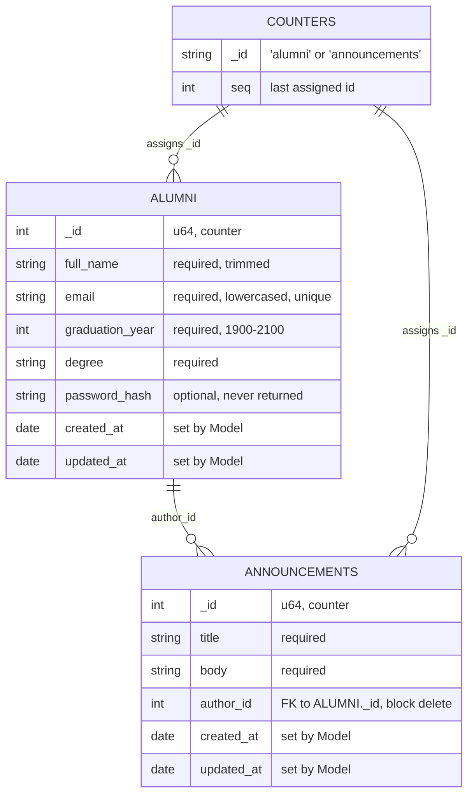

# Database Design Document (DDD)

Status: target design. The code does not follow this document yet.
Today `alumni` lives in MongoDB, `users` and `announcements` live in memory.
See `services/alumni-api/src/main.rs` and `docs/trade-offs.md`.
Implement this document to finish backlog item
"Persist users and announcements".

This document follows `README.md`. It uses one term for one thing.
It uses short sentences and the active voice.

## Terms

- `Alumni`: one graduate record. It lives in the `alumni` collection.
- `Announcement`: one news record. It lives in the `announcements` collection.
- `Counter`: one id counter record. It lives in the `counters` collection.
- `alumni-model`: the shared Rust crate (planned, see `README.md` Layout).
  It holds the structs and the data rules. The backend and the frontend
  import structs from it. No code copies structs.
- `Model`: structs, data rules, stores, and MongoDB.
- `Controller`: handlers. They call the Model. They hold no data rules.
- `View`: JSON responses built with serde. Views hold no data rules.
- `User`: retired term. `User` merges into `Alumni`.
  `README.md` still names `User` in Rules and in the MVC mapping.
  Update `README.md` when you implement this document.

## Database

- Server: MongoDB 7, container `mongo` on port 27017.
- Database name: `alumni` (env `MONGO_DB`).
- Collections: `alumni`, `announcements`, `counters`. No `users` collection.

## Alumni schema

One document per graduate. The `alumni-model` crate holds this struct.
The API never returns `password_hash`.

| Field | BSON type | Rust type | Required | Rule |
| --- | --- | --- | --- | --- |
| `_id` | int64 | u64, range `1..=i64::MAX` | yes | Server counter assigns it. Never reuse it. |
| `full_name` | string | String | yes | Trim it. Reject empty. |
| `email` | string | String | yes | Trim it. Lowercase it. Must contain `@` with non-empty parts. Unique. |
| `graduation_year` | int32 | i32 | yes | Range `1900..=2100`. |
| `degree` | string | String | yes | Trim it. Reject empty. Free text, no enum yet. |
| `password_hash` | string | Option\<String\> | no | Only auth code reads it. Never serialize it. Absent for seed rows. |
| `created_at` | date | bson::DateTime | yes | Model sets it on create. UTC. |
| `updated_at` | date | bson::DateTime | yes | Model sets it on create and on each update. UTC. |

Rules:

- All profile fields are required. `password_hash` is the only exception.
  It stays absent until the auth backlog item lands.
- The Model lowercases `email` before each write.
  The unique index then works with one rule in one place.
- Duplicate `email` fails in MongoDB with error `11000`.
  The Controller maps `11000` to status `400`.
- The Model sets timestamps. Controllers never set them.
- Sort by `_id`. Counter order equals time order.

## Announcements schema

One document per news record. The `alumni-model` crate holds this struct.

| Field | BSON type | Rust type | Required | Rule |
| --- | --- | --- | --- | --- |
| `_id` | int64 | u64, range `1..=i64::MAX` | yes | Server counter assigns it. Never reuse it. |
| `title` | string | String | yes | Trim it. Reject empty. |
| `body` | string | String | yes | Trim it. Reject empty. |
| `author_id` | int64 | u64 | yes | Must equal an existing `alumni._id`. |
| `created_at` | date | bson::DateTime | yes | Model sets it on create. UTC. |
| `updated_at` | date | bson::DateTime | yes | Model sets it on create and on each update. UTC. |

Rules:

- `author_id` replaces the old free-text `author` field.
  Old rows with text authors need a manual map before migration.
- Delete of an alumni row with announcements fails with status `400`.
  The Model checks `announcements` by `author_id` before it deletes.
- Sort by `_id`.

## Counters schema

One document per id series. It replaces `AtomicU64` in the old memory stores.

| Field | BSON type | Rust type | Required | Rule |
| --- | --- | --- | --- | --- |
| `_id` | string | String | yes | `"alumni"` or `"announcements"`. |
| `seq` | int64 | u64 | yes | Last assigned id. |

Rules:

- Assign ids with one atomic call: `findOneAndUpdate` with `$inc: {seq: 1}`,
  `upsert: true`, return-new. No `max + 1` reads.
- Start at `1`. Never go back. Deletes never return ids to the pool.
- The call runs inside the Model create function, not in the Controller.

## Indexes

Create indexes at API startup with `create_index`. Repeat runs must succeed.

- `alumni._id`: default primary index.
- `alumni.email`: unique index. No collation. App-side lowercase makes it act
  case-insensitive.
- `announcements._id`: default primary index.
- `announcements.author_id`: plain index. It speeds the block-delete check.

No indexes on `graduation_year`, `degree`, or `full_name` yet.
Filter queries scan until the search backlog item lands.
State this limit in the next backlog review.

## Relationships

```text
alumni (1) ──< announcements (author_id)
counters (1) ──  alumni + announcements (assigns _id)
```

- `announcements.author_id` references `alumni._id`. MongoDB checks nothing.
  The Model checks it on write and on alumni delete.
- No joins in reads. To show an author name, query `alumni` by `author_id`.
- No cascade deletes. Block wins over delete.

## Validation location

- Rust Model only. No `$jsonSchema` validator in this step.
- Controllers call Model functions and map errors to HTTP.
  The Model knows nothing about HTTP, routes, or pages.
- This fixes `README.md` known gap "`list_alumni` queries MongoDB directly":
  the query moves into a Model function.

## Seed and migration

Seed runs in development only. Never run it against production data.
`mongo-seed` uses `mongoimport --drop` today. Keep `--drop` for dev only.

Steps:

1. Stop the API. Drop dev database.
2. Import seed alumni as `_id` `1, 2, 3` with fixed UTC timestamps.
   Map old `"a1"`, `"a2"`, `"a3"` to `1`, `2`, `3`.
3. Set `counters` to `{_id: "alumni", seq: 3}` and
   `{_id: "announcements", seq: 0}`.
4. Move `UserStore` and `AnnouncementStore` to MongoDB Model functions.
5. Delete `UserController`, `ApiUserController`, `routes/user.rs`,
   `routes/api_user.rs`, `views/users.rs`.
   Remove `/users` from `frontend/nginx.conf`, Swagger tags, and user tests.
6. Create indexes from the Indexes section.
7. Update `README.md` Routes, MVC mapping, Rules, and Known gaps.

## Auth reserve

- `password_hash` lives in the `alumni` document. No separate auth collection
  in this step.
- No sessions collection in this step.
- Hash algorithm and login routes belong to the auth backlog item.
  This document reserves the field only.

## Deferred work

- Search indexes and text search on `full_name`.
- Pagination cursors for list routes.
- Stronger email format check.
- MongoDB `$jsonSchema` validator.
- `events` collection and `notifications` service.
- Sessions and password reset flow.

## Diagram


